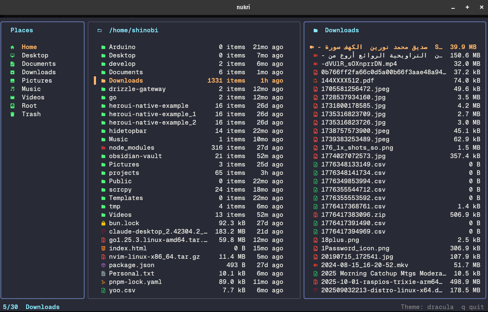

# Nukri

A fast terminal file manager for Linux, written in Go. Nukri is a work in progress.



## Install

On Linux (x86_64 or arm64):

```bash
curl -fsSL https://nukri.urdadx.com/install.sh | sh
```

It offers to install the optional tools previews use (ffmpeg, rsvg-convert, poppler
and more). To pin a version:

```bash
curl -fsSL https://nukri.urdadx.com/install.sh | NUKRI_VERSION=0.1.0 sh
```

Or, with Go installed:

```bash
go install github.com/urdadx/nukri/cmd/nukri@latest
```

This puts `nukri` in `~/go/bin`. Icons need a [Nerd Font](https://www.nerdfonts.com/).

## Features

- **Three panes**: places and mounted devices, the file list, and a live preview. The
  layout adapts to the terminal's size, and `P` hides the preview.
- **Rich previews**: syntax-highlighted code, Markdown, CSV, images (kitty graphics or
  sixel), video frames, audio waveforms, PDF pages, office documents, ebooks, fonts,
  torrents, ISO images, and the contents of folders and archives.
- **File operations**: mark several items, then copy, cut and paste, create, rename
  inline or in your editor, trash and restore, or delete permanently.
- **Archives**: create zip, tar and tar.gz archives, and extract them.
- **Fuzzy find** across the current folder tree.
- **Duplicate finder** that shows how much space you can reclaim.
- **Drag and drop** in kitty 0.47+, in both directions, including over SSH.
- **Open** files with their default app or a chosen one, and copy names or paths to the
  clipboard.
- **21 themes**, previewed live as you pick, plus your own.
- **Mouse support**: click, double-click and scroll.

## Contributing

See [CONTRIBUTING.md](CONTRIBUTING.md).

## License

[MIT](LICENSE)
