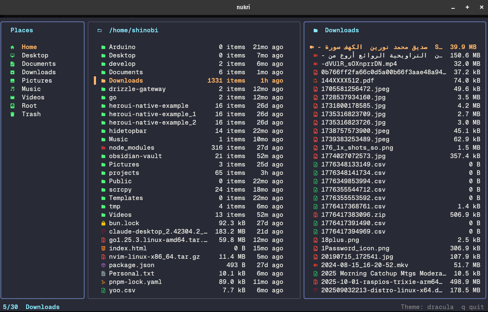

## Install

```bash
curl -fsSL https://nukri.urdadx.com/install.sh | sh
```

Then run `nukri` in any folder. See [Getting started](/getting-started) for requirements and other install methods.

## Features

- **Three panes:** places, files, and a live preview. The layout fits your terminal.
- **Rich previews:** code, CSV, images, video, audio, PDF, office documents, fonts, archives and more.
- **File operations:** copy, move, create, rename (inline or in your editor), trash and restore.
- **Archives:** create and extract zip, tar and tar.gz.
- **Fuzzy find** across the current folder tree.
- **Duplicate finder** that shows how much space you can get back.
- **Drag and drop** in kitty, even over SSH.
- **21 themes**, plus your own.
- **Mouse support.**

:::note
Nukri is a work in progress and runs on Linux only for now.
:::

## Next steps

<CardGroup cols={2}>
  <Card title="Getting started" href="/getting-started" icon="rocket">
    Install Nukri and learn the first keys.
  </Card>
  <Card title="Keyboard shortcuts" href="/keys" icon="keyboard">
    Every key on one page.
  </Card>
  <Card title="Previews" href="/previews" icon="eye">
    What's previewed and which tools to install.
  </Card>
  <Card title="Troubleshooting" href="/troubleshooting" icon="life-buoy">
    Fixes for common problems.
  </Card>
</CardGroup>

Found a bug or want a feature? [Open an issue on GitHub](https://github.com/urdadx/nukri/issues).
